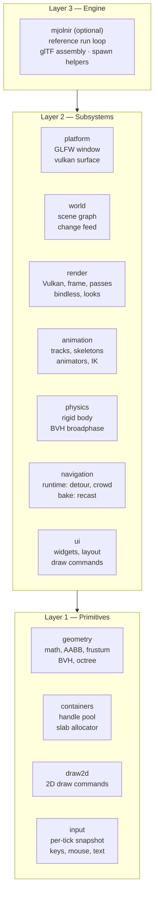

Mjolnir is a deferred-shading, bindless, GPU-driven game engine in
Odin + Vulkan 1.3. This page is about *why* the engine is shaped the
way it is, not what the code does.

## Guiding rules

1. **Single source of truth.** Don't store derived state unless
   profiling demands it.
2. **No duplicated data across structs.** No pointer fields on
   structs — handles only.
3. **Keep struct definition count to a minimum.**
4. **Modules in layers.** Dependency goes top → bottom only.
5. **Avoid indirection / wrappers** when the underlying call already
   reads well.
6. **Do not leak internal detail to user code.**
7. **Expose Vulkan.** Vulkan is not hidden; mjolnir codifies the
   patterns that make it manageable.

---

## Layered modules

The codebase splits into three layers. **Higher layer depends on
lower; never the reverse, never sideways.** Every layer-2 module
compiles and runs without its siblings, so each can be swapped out or
split into its own repository.



- No layer-2 module imports another layer-2 module.
- `render` is the only Vulkan user. Its subpackage `render/gpu` is
  the Vulkan layer (context, swapchain, buffers, images, pipelines,
  deferred destruction and the bindless descriptor-array mechanism).
  `render/bindless` defines render's own arrays (textures, samplers,
  cube maps, the mesh arena, the scene set, the indirect draw lists)
  and `render/mesh` the vertex format, primitive builders and OBJ
  loader. Shaders (`render/shader`)
  and embedded assets (`render/assets`) live inside the module, so
  the folder lifts out whole.
- `platform` is the only GLFW user, including layer 3 and the
  examples. It hands render the instance extensions, the
  proc-address loader and a surface; render never sees a window. It
  writes device events into an `input.Accumulator`; everything else
  reads the per-tick `input.State` snapshot.
- `geometry` is math and spatial structures only. No vertex formats,
  no Vulkan.
- `navigation` splits into a runtime (`navigation`,
  `navigation/detour`, `navigation/crowd`) that never imports Recast
  and a baker (`navigation/bake`) that turns triangles into a
  `NavMesh`; `navigation.init` loads pre-baked data.
- `animation` is headless: it samples tracks and poses skeletons
  into flat arrays. Applying the result (moving a node, uploading a
  skin palette) is the caller's job.

### Layer 3

The `mjolnir` package is optional. It is a reference run loop (window,
input snapshot, update and render cadence), glTF scene assembly
(world nodes over the `render/gltf` and `animation/gltf` loaders) and
a few basic spawn helpers (world node + render attachment). It runs
no glue between modules: `world.update`, the world → render feed,
skin palettes and physics poses are all the application's `update`
callback. Layer-3 code uses only public layer-2 APIs, so user code
can always rewrite it. Code that touches a single module belongs in
that module.

---

## World vs render

**World is the logical world; render is the looks.**

- `world` holds nodes: hierarchy, transforms, visibility and user
  tag bits. No meshes, materials, lights, cameras or skeletons. It
  runs headless.
- `render` owns everything that only affects appearance: meshes,
  materials, textures, sprites, emitters, force fields, lights and
  cameras, plus their staging into GPU buffers.
- `animation` owns poses. An `Animator` is a plain value the
  application keeps next to the node it drives.

The boundary is the **transform slot**: a `u32` that render keys
every instance on. The convention is slot = world node index, so
`render.attach(&r, node.index, ...)` puts a look on a node. World
publishes what changed each update; render consumes it. Neither
imports the other.

---

## Glue

**Modules never call each other, and the engine provides no glue.**
Cross-module glue is user code made of trivial feed → consume loops;
each module owns its own timing and thread safety, so a hop never
needs scheduling or locking. The world → render hop, for example:

```odin
world.update(&e.world)
for i in world.removed_nodes(&e.world) do render.stage_slot_removal(&e.render, i)
for n in world.changed_nodes(&e.world) do render.stage_transform(&e.render, n.index, n.world_matrix, n.visible)
```

With the layer-3 run loop these lines live in the `update` callback,
next to the physics pose copy and one
`render.stage_bones(&e.render, node.index, animator.palette)` per
skinned node. See [glue](glue.html) for every hop.

---

## Frame phases

```
update thread: input snapshot → UI input → camera controller → update (app + glue) → render.update
render thread: poll events → throttle → ui stage → pre_render
               → render.frame (flush → acquire → record → submit + present) → post_render
```

- **Update** runs at `UPDATE_FPS` (defaults to `RENDER_FPS`). On its
  own thread if `USE_PARALLEL_UPDATE=true`.
- **Glue** runs inside the `update` callback on the update thread;
  every `render.stage_*` and `render.attach` call is thread-safe.
  `render.update` advances render's own clock (emitters, debug line
  lifetimes).
- **Frame** is one `render.frame` call on the render thread: it
  drains staging into GPU buffers, acquires a swapchain image
  (recreating the swapchain on resize), records, submits, presents
  and retires deferred GPU resources.
- **Record** builds the full pipeline (cull → shadow → geometry →
  lighting → particles → transparency → debug → post-process → UI)
  via dynamic rendering. The UI pass draws game UI and the debug UI.

Update and render are decoupled. Render's staging is the only contact
point.

---

## Render-owned staging

Mutating a look (`attach`, `stage_transform`, `mark_slot_dirty`,
`create_mesh`, …) writes CPU state and marks the slot dirty in a
mutex-guarded staging set. `render.frame` uploads dirty entries once
per frame on the render thread.

- **Each entry ages per upload.** An update is re-uploaded until
  every frame in flight has it, then dropped.
- **Releases are deferred by `FRAMES_IN_FLIGHT`.** A removal doesn't
  free GPU memory until the GPU is past every frame that might still
  read it. No fence chain per resource.
- **Despawned node slots are held back.** World keeps a despawned
  node's index reserved for `RETIRE_GRACE` updates so the removal
  reaches render before the slot is reused.

---

## Cameras as first-class render targets

Cameras live in render. Each `Camera` carries per-frame attachments
for every G-buffer slot and renders the full scene. The main camera is
the one post-processed and presented; a minimap is just another
camera.

`render.camera_attachment(&r, cam, .FINAL_IMAGE, frame)` returns a
bindless texture handle. Compositing camera B's output into camera
A's material or UI quad is just another bindless index.

Following a logical entity is one glue line:
`render.camera_set_transform(cam, world.world_matrix(&w, player))`.
Orbit, free and follow controllers are render procs that read the
per-tick `input.State` with fixed keys; the engine runs
the active one each update tick.

---

## Deferred shading + light volumes

Forward shading scales as `pixels × lights`. The G-buffer is filled
once; ambient + IBL run as a single fullscreen pass; each direct
light rasterizes its volume (sphere / cone / fullscreen triangle)
with reversed depth so only fragments it can reach get shaded.
Avoids the per-pixel-per-light loop without needing tile or cluster
infrastructure.

---

## Shadows

- **2D maps** for directional + spot. Compute pass clips against the
  light frustum; depth-only graphics pass writes a 512² slice.
- **Cubemap** for point lights. Geometry-shader-amplified single
  draw renders all six faces (`-define:REQUIRE_GEOMETRY_SHADER=true`
  required at build).

Shadow maps live in `MAX_SHADOW_MAPS` fixed slots, handed out each
frame to the first shadow casters in slot order.

---

## Physics step

Physics is a user-owned `physics.World`. The user steps it and copies
poses back into the scene graph:

```odin
physics.step(&phys, dt)
for b in physics.body_poses(&phys) do world.set_world_pose(&e.world, world.NodeHandle(b.user), b.position, b.rotation)
```

Inside `step`:

```
sleep timers → warmstart cache → gravity → integrate velocity
            → CCD pass (clamp dt for fast bodies)
            → BVH rebuild (only if kill-count above threshold)

substep × NUM_SUBSTEPS:
  refit → broadphase → narrow-phase → prepare contact
  → warmstart (first substep) → solver iters → stabilization iters
  → integrate position + rotation → cached AABB

trigger overlap → defer-kill bodies below KILL_Y
```

Key choices: BVH (not grid) broadphase, refit-most-frames /
rebuild-when-dirty, warmstart from previous frame, Baumgarte bias
with a separate bias-free stabilization pass, deferred kills to keep
handle generations stable inside a step.

---

## Where to go next

- [`glue`](glue.html) — wiring modules together in user code.
- [`engine`](engine.html), [`platform`](platform.html),
  [`world`](world.html), [`render`](render.html),
  [`physics`](physics.html), [`navigation`](navigation.html),
  [`ui`](ui.html), [`animation`](animation.html) — module intros.
- [`examples`](examples.html) — runnable examples and notes.
