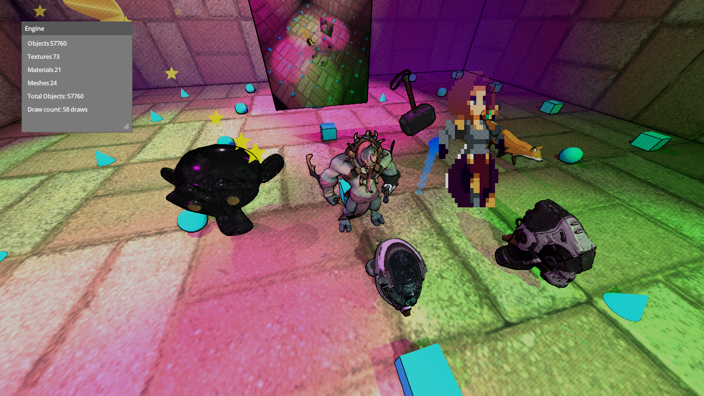

[Mjolnir](https://github.com/hucancode/mjolnir) is a minimalistic, bindless,
GPU-driven game engine in Odin + Vulkan 1.3.



## Get started

To use Mjolnir, run `make shader` to compile shaders to SPIR-V and copy the
`mjolnir/` directory into your project.

## Notable features

- Physically-based rendering with IBL
- Cameras, lights, shadows (point / spot / directional, 2D + cubemap)
- Cameras as render targets — sample any camera output as a texture
- Skeletal animation with FK, IK (FABRIK), procedural modifiers
- Animation layering with bone masks, blend modes, transitions
- Procedural animation: tail follow-through, spider legs, path-on-spline
- glTF + OBJ loading
- Particle simulation + force fields
- Billboards, sprites
- Splines, tweens
- Rigid-body physics (tunneling-safe for fast bodies)
- Recast + Detour navigation, crowd steering
- 2D UI: widgets, layout, events, fontstash text
- Render to texture
- Post-process: tonemap, bloom, blur, fog, outline, DoF, crosshatch

## Build commands

```bash
# Build and run in release mode
make run
# Build and run in debug + Vulkan validation
make debug
# Build only
make build         # release
make build-debug   # debug
# Build all shaders
make shader
# Run all tests
odin test . --all-packages
# Run a single test
odin test . --all-packages -define:ODIN_TEST_NAMES=module_name.test_name
```

## Build flags

| Flag | Default | Effect |
|---|---|---|
| `FRAMES_IN_FLIGHT` | 2 | GPU frame buffering. |
| `RENDER_FPS` | 60 | Target render cadence. |
| `UPDATE_FPS` | `RENDER_FPS` | Target update cadence. |
| `USE_PARALLEL_UPDATE` | false | Run `update` on a dedicated thread. |
| `FRAME_LIMIT` | 0 | Cap total frames (0 = unlimited). |
| `REQUIRE_GEOMETRY_SHADER` | false | Required for cubemap point-light shadows. |

## Debugging tips

- For visual issues: build with `-define:FRAME_LIMIT=10`, inspect logs.
- Capture screenshots with `make capture`.
- Slow the renderer with `-define:RENDER_FPS=4` to read render logs frame by frame.
- Call `render.debug_ui(&r)` in the `frame` callback for the microui overlay, or pass `show_stats = true` to `render.frame` for renderer stats.

## Read more

- [`architecture`](architecture.html) — layer design, frame phases,
  world/render boundary, staging, bindless + GPU-driven model
- [`engine`](engine.html) — building an application and wiring modules together
- [`examples`](examples.html) — runnable examples with notes

## Module intros

| Layer | Module |
|---|---|
| 1 | [containers](containers.html) |
| 1 | [geometry](geometry.html) |
| 1 | [input](input.html) |
| 2 | [platform](platform.html) |
| 2 | [world](world.html) |
| 2 | [render](render.html)|
| 2 | [animation](animation.html) |
| 2 | [physics](physics.html) |
| 2 | [navigation](navigation.html) |
| 3 | [engine](engine.html) |
